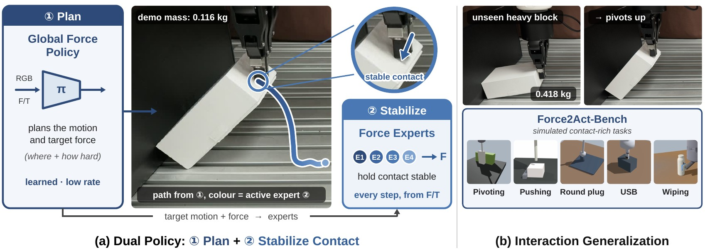
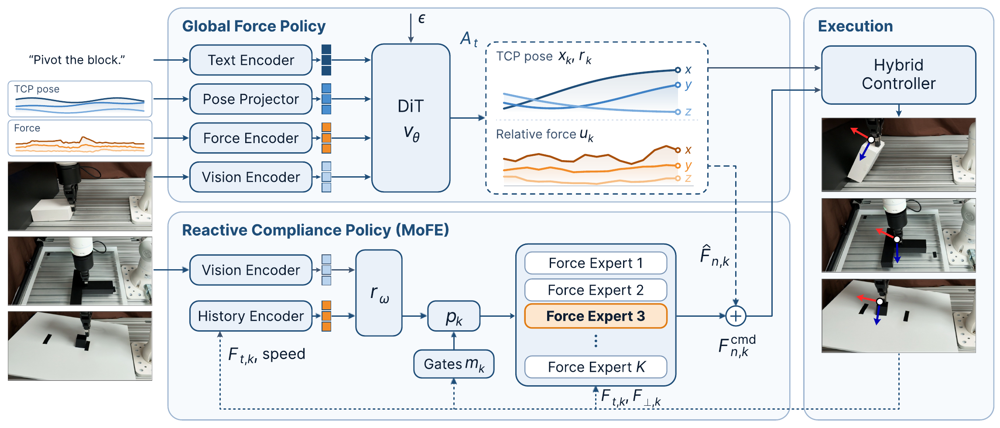
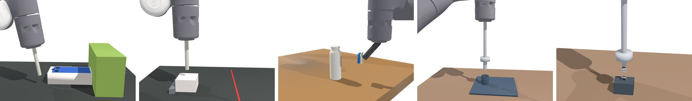

<div align="center">

# Force2Act: A Force-Aware Visuomotor Policy for Generalizable Compliant Robot Manipulation

Keerthi Vasan Murugan<sup>1</sup>,
Fangguo Zhao<sup>1,2</sup>,
[Jiafei Duan](https://jiafei1224.github.io/)<sup>1,*</sup>

<sup>1</sup>National University of Singapore &nbsp; <sup>2</sup>Zhejiang University &nbsp; <sup>*</sup>Corresponding author

[Paper](https://magiclab-nus.github.io/Force2Act/Force2Act.pdf) · [Project Page](https://magiclab-nus.github.io/Force2Act/) · [Models](https://huggingface.co/NUSMAGIC/Force2Act-Sim) · [Dataset](https://huggingface.co/datasets/NUSMAGIC/Force2Act-Bench-Data) · [BibTeX](#citation)

<!-- TODO: point the Paper link to arXiv once it is announced: https://arxiv.org/abs/XXXX.XXXXX -->



</div>

## Overview

Contact-rich manipulation requires a robot to regulate the force it applies, not only where it moves.
Policies that learn this force from demonstrations reproduce the force levels they were trained on, which
fails once the interaction demands more force than any demonstration: a heavier object, a steeper support.

Force2Act is a hybrid force–position policy built on two complementary mechanisms:

- A **global force policy** plans chunks of poses and wrenches with flow matching, once per action chunk.
  It sees and predicts force relative to its recent magnitude, so the planned force scales with the load.
- A **Mixture of Force Experts (MoFE)** sets the normal force at every control step from seven learned
  contact laws (pushing, two sticking laws, three sliding levels, insertion). A router chooses among the
  laws that the measured contact geometry admits.

A hybrid motion–force controller executes the result.

<p align="center">
  
</p>

Force2Act reaches **93.8%** on Force2Act-Bench, against 77.0% for the strongest baseline, and **94.2%** on a real
robot over four tasks, against at most 27.5% for the baselines. Full results and rollout videos are on the
[project page](https://magiclab-nus.github.io/Force2Act/).

This repository contains Force2Act (training and inference) and **Force2Act-Bench**, five contact-rich
manipulation tasks in [Genesis](https://github.com/Genesis-Embodied-AI/Genesis).

<p align="center">
  
  <br>
  <em>Force2Act-Bench: block pivoting, press-push box, bottle wiping, round-plug insertion and USB insertion.</em>
</p>

| | |
|---|---|
| Models | [`NUSMAGIC/Force2Act-Sim`](https://huggingface.co/NUSMAGIC/Force2Act-Sim) |
| Demonstrations | [`NUSMAGIC/Force2Act-Bench-Data`](https://huggingface.co/datasets/NUSMAGIC/Force2Act-Bench-Data) |
| Videos and results | [magiclab-nus.github.io/Force2Act](https://magiclab-nus.github.io/Force2Act/) |

## Contents

- [Installation](#installation)
- [Evaluate Force2Act](#evaluate-force2act)
- [Evaluate Your Own Policy](#evaluate-your-own-policy)
- [Train](#train)
- [Use Force2Act in Your Own Loop](#use-force2act-in-your-own-loop)
- [Citation](#citation)
- [Acknowledgements](#acknowledgements)
- [License](#license)

## Installation

```bash
git clone https://github.com/MAGICLAB-NUS/Force2Act.git && cd Force2Act
conda create -n force2act python=3.12 && conda activate force2act
pip install torch==2.7.1 torchvision==0.22.1 --index-url https://download.pytorch.org/whl/cu126
pip install -e ".[bench,train]"
```

The benchmark renders its cameras with EGL and needs an NVIDIA GPU.

## Evaluate Force2Act

```bash
force2act-bench --task pivot_block
```

This downloads the trained policy and MoFE, runs the task's full protocol in parallel (`--workers`, default
8) and writes `results/pivot_block/summary.md` and `results.jsonl`. Add `--video` to save one video per
trial, or `--trials N` for a quick run.

| Task | Conditions | Trials | Force2Act |
|---|---|---|---|
| `pivot_block` | block mass 0.4–0.9 kg | 6 × 25 | 93.3% |
| `push_box` | incline 0°, 2°, 4° | 3 × 10 | 100% |
| `bottle_wiping` | random ink line | 50 | 98.0% |
| `plug_insertion_round` | hole at the demonstrated position, displaced by 2 mm | 2 × 25 | 96.0% |
| `plug_insertion_usb` | socket at the demonstrated position | 25 | 76.0% |

## Evaluate Your Own Policy

A policy is any object with `reset(seed)`, `act(observation) -> Action` and `needs_image()`:

```python
from force2act_bench.sim import Action

class MyPolicy:
    def reset(self, seed): ...
    def needs_image(self): return True
    def act(self, observation):
        # observation: tcp_position, tcp_quaternion_wxyz (world), tcp_wrench (environment on tool,
        # TCP axes), joint_positions, rgb {camera: H x W x 3 uint8}
        return Action(tcp_position=..., tcp_quaternion_wxyz=...)

def make_policy(**kwargs):
    return MyPolicy()
```

```bash
force2act-bench --task push_box --policy my_package.my_policy:make_policy --control impedance
```

| `--control` | The action sets |
|---|---|
| `position` | the TCP pose, tracked by inverse kinematics and joint PD control |
| `impedance` | the TCP pose, tracked by a Cartesian impedance (2000 N/m, 100 Nm/rad) |
| `hybrid` | the TCP pose, and the wrench on the axes in `action.force_control_axes`, expressed in the frame `action.force_frame_rotation_wxyz` |

Options can also be collected in a YAML file and passed with `--config` (see `configs/bench/`).

## Train

```bash
hf download NUSMAGIC/Force2Act-Bench-Data --repo-type dataset --local-dir data

# global force policy, one per task (60 epochs)
force2act-train --config configs/policy/pivot_block.yaml --output runs/pivot_block

# MoFE, one model for all tasks (10 epochs)
force2act-train-mofe --configs configs/policy/*.yaml --output runs/mofe

force2act-bench --task pivot_block --checkpoint runs/pivot_block --mofe runs/mofe
```

The MoFE ablations of the paper are available as flags: `--no-gates`, `--router-sees-direction`,
`--one-per-case`, `--offset-bound 60` and `--lam 0`.

## Use Force2Act in Your Own Loop

```python
from force2act.agent import Force2ActAgent

agent = Force2ActAgent.from_pretrained("hf://NUSMAGIC/Force2Act-Sim/pivot_block")
agent.reset()
command = agent.act(position, quaternion_wxyz, wrench_world, image)   # at 15 Hz
# command.position, command.quaternion_wxyz: pose target
# command.force_axes, command.frame_quaternion_wxyz, command.wrench: hybrid force command
```

## Citation

If you find Force2Act or Force2Act-Bench useful in your research, please cite:

```bibtex
@misc{murugan2026force2act,
  title  = {Force2Act: A Force-Aware Visuomotor Policy for Generalizable Compliant Robot Manipulation},
  author = {Murugan, Keerthi Vasan and Zhao, Fangguo and Duan, Jiafei},
  year   = {2026}
}
```

## Acknowledgements

The normalizer and EMA utilities are adapted from [ManiFlow](https://github.com/geyan21/ManiFlow_Policy) (MIT).
The flow-time distribution follows [π0](https://github.com/Physical-Intelligence/openpi), and inference uses
[real-time chunking](https://github.com/Physical-Intelligence/real-time-chunking-kinetix). Demonstrations use the
[LeRobot](https://github.com/huggingface/lerobot) format.

## License

Released under the MIT license. See [LICENSE](LICENSE).
